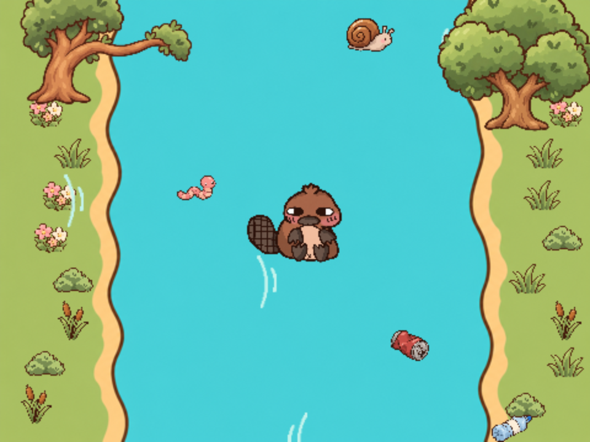

# Lazy Tofu! — Scratch project

Build a scrolling river game in Scratch. Help Tofu the Platypus collect food, dodge rubbish and avoid the trees.

This is the separate, unlisted Scratch project-site version of [editor-lazy-tofu](https://github.com/raspberrypilearning/editor-lazy-tofu), for learners aged 10–14. It follows the grouped task-panel format of [Dino Jump](https://projects.raspberrypi.org/en/projects/dino-jump), with a playable introduction and explicit Scratch starter/remix instructions.

Project page: [projects.raspberrypi.org/en/projects/lazy-tofu](https://projects.raspberrypi.org/en/projects/lazy-tofu).

Scratch links: [completed game](https://scratch.mit.edu/projects/1438005262/), [starter project](https://scratch.mit.edu/projects/1438003425/editor/).

The Tofu the Platypus sprite was submitted as part of the ‘Your Club, Your Sprite’ initiative by Gabriella van Niekerk from Holy Cross Coding club in South Africa.

## Resources
See [the English tutorial](en/meta.yml), [offline starter](en/resources/lazy-tofu-starter.sb3) and [solution](en/solutions/lazy-tofu-complete.sb3).

Source preservation, format choices and checks are recorded in [.github/authoring/README.md](.github/authoring/README.md).

## Contributing
See [CONTRIBUTING.md](CONTRIBUTING.md)

## Licence
See [LICENCE.md](LICENCE.md)

## Setting up a Crowdin project

See [CROWDIN.md](CROWDIN.md).
