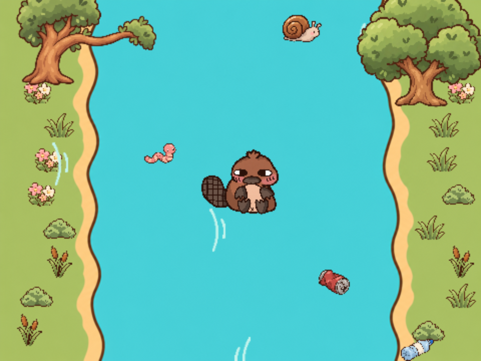

## What you will make

Build a **Lazy Tofu!** game in Scratch. Help Tofu the Platypus swim for food while avoiding the trees and rubbish in the river.

Click the green flag, then use **space** to wake Tofu. Use the **left and right arrow keys** to swim. Food adds points; rubbish and trees cost health. Try the speed slider when you're ready for a faster river.

> [!NOPRINT]
>
> 

>  <iframe title="Play the completed Lazy Tofu game" allowtransparency="true" width="485" height="402" src="https://scratch.mit.edu/projects/embed/1438005262/?autostart=false" frameborder="0" allowfullscreen></iframe>
> 

>
> [Open the completed game in Scratch](https://scratch.mit.edu/projects/1438005262/){:target="_blank"}.

> [!PRINTONLY]
>
> 

You'll make the river appear to flow by moving clones past Tofu. Build one river bank, reuse your code on the other, then add food, sounds and Tofu's full wake-up animation.

The Tofu the Platypus sprite was submitted as part of the ‘Your Club, Your Sprite’ initiative by Gabriella van Niekerk from Holy Cross Coding club in South Africa.
